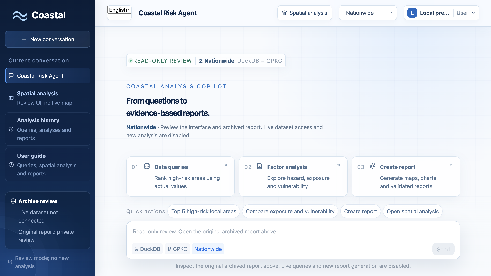
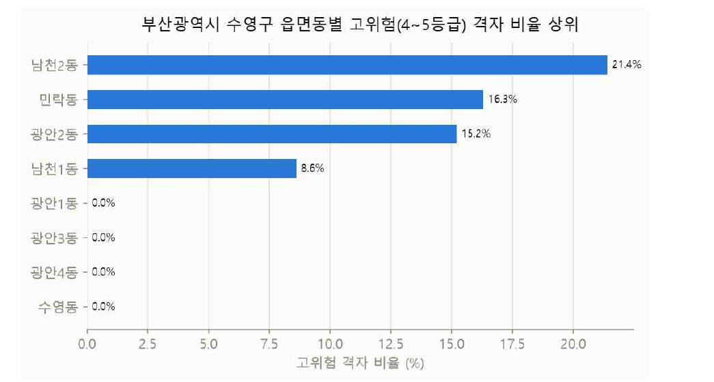
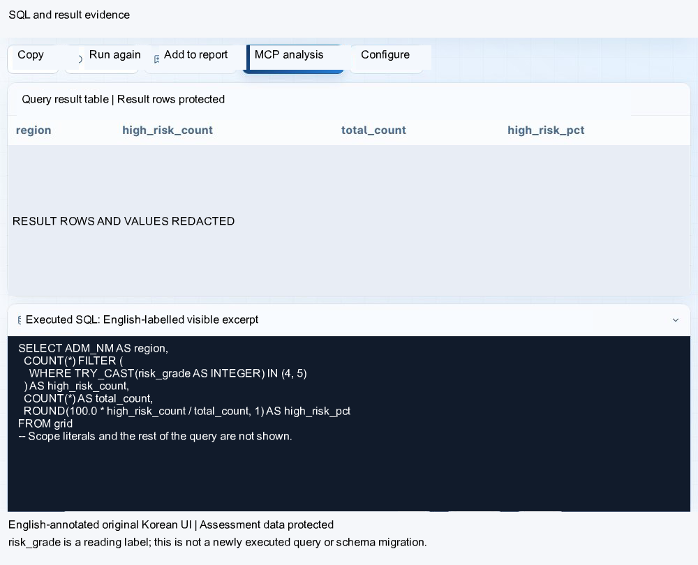
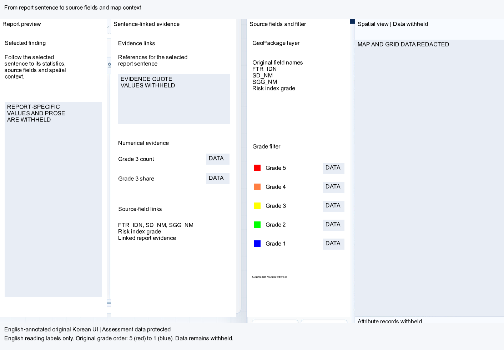
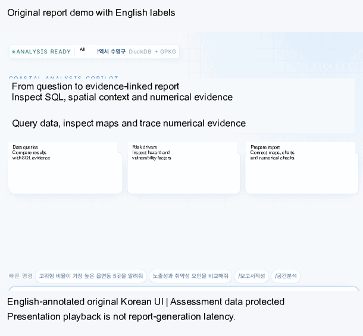
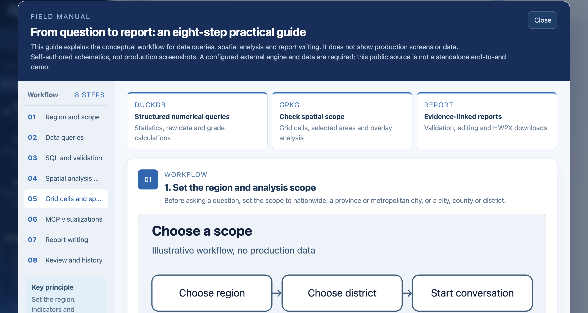

# Coastal Hazard Intelligence Agent

<picture>
  <source media="(prefers-color-scheme: dark)" srcset="docs/assets/portfolio/geosr-logo-white.png">
  
</picture>

**Portfolio source, actual English UI previews and selected original report figures for a geospatial analysis and evidence-linked reporting application.**

I co-developed the system with an AI-team colleague, connecting map-based selection, scoped SQL, analysis, visualization, numerical checks and report preparation. The source assessment dataset was prepared separately; this work does not claim ownership of that dataset.

## Actual English frontend preview

*An actual React-rendered English interface, cropped from the local localization review build, not English text painted onto a Korean screenshot. It is explicitly read-only: live dataset access, analysis submissions and new report generation are disabled.*

The [English-localization source patch and review notes](docs/assets/portfolio/README_EXCERPTS.md#review-source-not-a-silent-main-branch-replacement) are provided separately. The patch is **not yet applied to the main-branch frontend**. The native-English preview, the Korean archived report and the historical English-annotated captures below are distinct evidence.

## Why this exists

GIS selection, analysis tables, charts and report writing often live in separate tools. This application connects them while keeping executed queries and supporting results available for review.

## Original report: selected output excerpts

**Archived output:** Busan Metropolitan City, Suyeong-gu, **14 July 2026**. The report is the original Korean document, not a recreated example or a newly generated English report.

*Selected aggregate comparison: the share of grade-4/5 high-risk grid cells by neighbourhood. The original labels, displayed values, geometry and colours are unchanged. The surrounding raw-data table and detailed grid map are not included. This is report-output evidence, not an accuracy benchmark or a current hazard advisory.*

See [crop provenance, review-source scope and data boundaries](docs/assets/portfolio/README_EXCERPTS.md). The full PDF and underlying assessment records are not distributed.

## Historical application evidence

The following captures come from the original Korean application, with **English reading annotations and data-protection masks**. Unlike the native-English preview above, these are edited historical captures, not English-runtime screenshots.

### Executed SQL stays beside the result

Review the executed query and result-table structure in the same workflow. English SQL field labels and readable excerpts are reading annotations, not newly executed queries or a migrated schema. Result figures and row contents are covered, not replaced with invented sample values or altered numerical results.

### Report sentences link back to their evidence

The original interface connects report prose, statistical keys, source-field names and map context. Detailed report values, map/grid content and attribute records are protected in this portfolio image.

### Report generation is a staged background workflow

All three frames of the original demo sequence are English-annotated and data-protected, showing the reporting interface and stage transitions. **Playback speed is not execution latency**, and the historical verification status is not a new accuracy benchmark.

Explore [all English-annotated original captures and data-protection notes](docs/assets/portfolio/README.md), including selected-area analysis. Read the [edited internal engineering review](docs/ENGINEERING_REVIEW.md) for the rationale behind scope enforcement, cancellation/state integrity, queueing and chart semantics. The review distinguishes dated recommendations from mechanisms supported by the current source.

Actual English user-guide preview

The dialog itself is rendered by the localized React frontend. Its diagrams describe a conceptual workflow and are not production screenshots or report data.

## Engineering decisions

- **Server-side selection scope:** selected grid IDs constrain subsequent queries rather than only changing the displayed map.
- **Evidence-linked results:** retain executed SQL, result tables and available report evidence so a reviewer can trace a figure back to its source.
- **Separate interactive and background work:** FastAPI handles requests while Redis/RQ coordinates report jobs. PostgreSQL persists users, sessions and history.
- **Explicit reporting stages:** integrate ingest, analysis, visualization, narration, verification, assembly and conversion through a separate reporting engine.
- **MCP integration:** pass scoped analysis results to data-analysis and charting tools.

These are implementation/design features, not guarantees of universal factual accuracy, zero hallucinations or production availability.

## What this public copy contains

- Python/FastAPI web and service-integration code
- React/TypeScript main-branch UI (Korean), plus an unapplied English-localization review patch and two actual English-runtime crops
- Deployment examples, schema migrations and automated tests
- Four English-annotated original application screenshots and a three-frame demo, with sensitive/data-specific areas covered
- Two selected report-image crops: the original cover heading and regional aggregate chart
- Two original GeoSR logo assets and an edited historical internal engineering review
- Separately labelled illustrative workflow schematics in the application guide

Original media and internal documentation are **not excluded as a category**: the important portfolio materials are included after data-focused review. Raw assessment files, customer documents, unredacted result rows/maps, full generated report PDFs, deployment secrets and the original private Git history remain excluded. Captions distinguish actual English-runtime previews, original Korean report crops, English-annotated historical captures and illustrative diagrams. The selected report chart retains aggregate values, but underlying assessment records are not released. None is a new benchmark or proof of current full-service reproducibility.

## Important dependency boundary

**This is a source extract, not a clone-and-run end-to-end demo.** The original workflow needs a separately provisioned compatible analysis/report engine, its coastal_agent Python package and compatible geospatial data. Those components and the underlying assessment dataset are not distributed here.

The checked-in configuration uses generic paths and placeholder values. Configure your own engine path and runtime secrets; never deploy with example credentials. The application does not provide a public hosted endpoint.

## Stack

Python, FastAPI, React, TypeScript, DuckDB, GeoPackage, PostgreSQL, Redis/RQ, Docker Compose and Nginx. The external reporting integration uses LangGraph, and visualization integrates [Data-Analyze-MCP](https://github.com/chaeminyoon/Data-Analyze-MCP).

## Development and validation

Use **Node 24.14 or later in the Node 24 line** for the frontend. The original container runtime targets Python 3.12; see the validation record for the Python version actually tested for this public copy.

### Frontend-only checks

~~~sh
cd frontend
npm ci
npm test
npm run build
~~~

A frontend build is not evidence that the dataset-backed service can run without its external dependencies.

### Backend checks

Build the frontend assets first (as above), because the API root test serves `frontend/dist`. Install the declared requirements in an isolated Python environment, then run **python -m pytest -q tests** from the repository root. PostgreSQL integration tests require an explicitly supplied test database. The full backend suite is not self-contained: report-verification and spatial-join tests require the separately provisioned `coastal_agent` package and currently fail without it. The external-engine-specific HWPX test is skipped when its optional engine module is unavailable. Neither failures nor dependency-related skips are evidence that the external integration passed.

See [validation details](docs/VALIDATION.md), [feature boundaries](docs/FEATURES.md) and [security guidance](SECURITY.md). Historical operational timings and test counts from the private system are intentionally not reused as current results.

## Data, attribution and licensing

This source is shared for portfolio review with release permission. Public visibility is not a general open-source license grant. Third-party dependencies and map services retain their own licenses and terms; see [third-party notes](THIRD_PARTY_NOTICES.md). Selected original logos, protected application captures and the reviewed report-image excerpts are included with release permission. The underlying assessment data is not redistributed. Branding identifies the historical project context, not a new endorsement.
