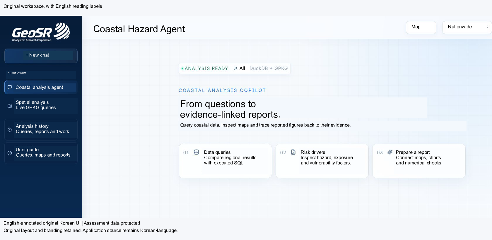
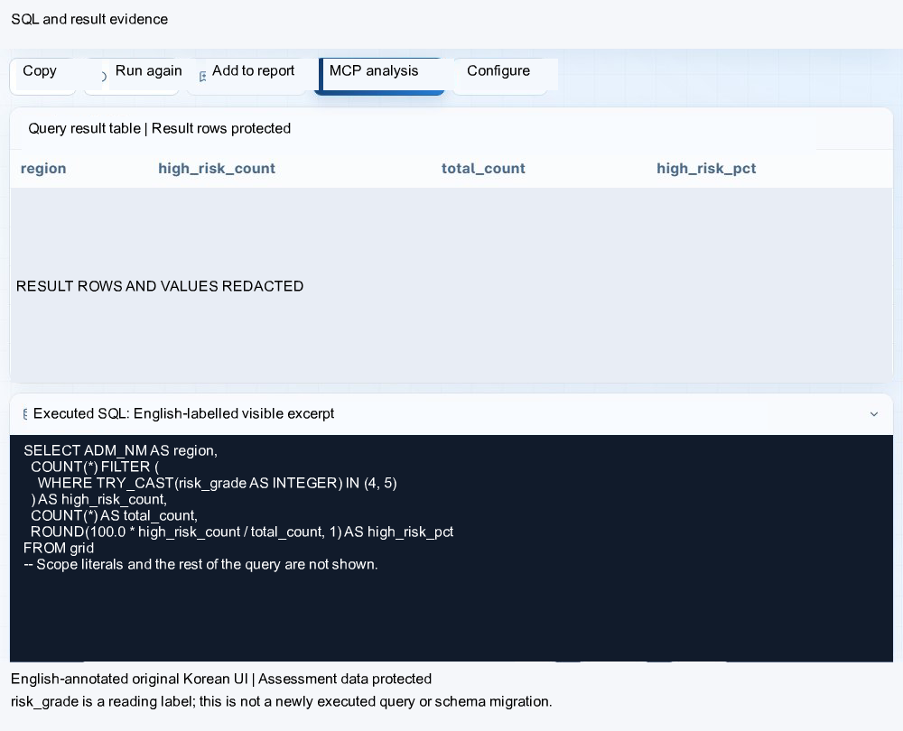
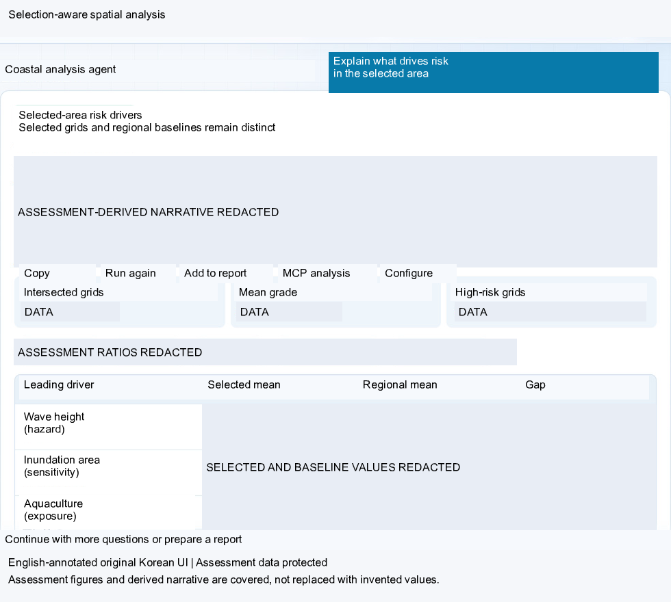
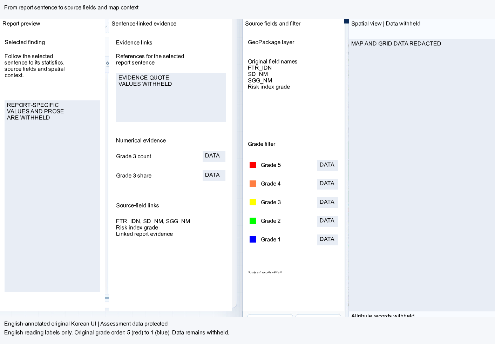
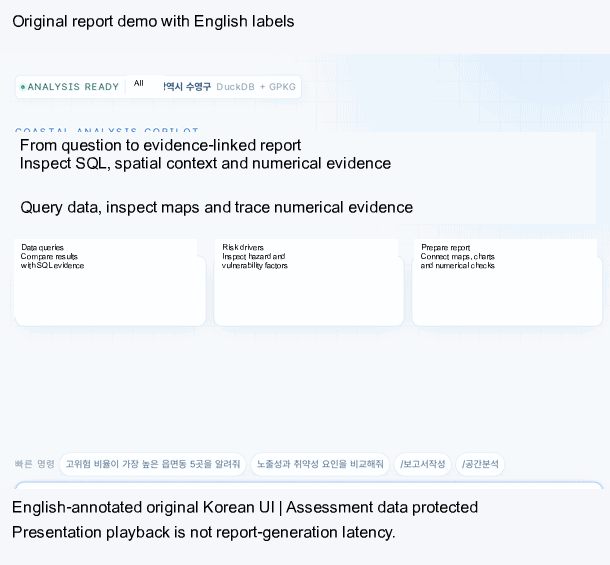

# Selected original project materials

These are four English-annotated original application screenshots, a three-frame GIF and two original GeoSR logo assets, published for portfolio review with release permission. They are not synthetic UI mockups. Major UI labels and explanations are translated for portfolio readability over original capture pixels, retaining the original layout, branding and workflow. They are not untouched, pixel-exact copies, native-English runtime screenshots or screenshots of an English-localized product. The application interface and source remain Korean.

## Data-protection treatment

- Raw assessment databases, GeoPackage/shapefile/CSV exports, customer documents and full generated report PDFs are not included.
- Opaque masks cover result rows, assessment figures, record identifiers, detailed map/grid panes, account details and selected query-scope literals. No synthetic assessment values or replacement numerical results are supplied.
- The PNGs are flattened re-encodings with English reading annotations and opaque data-protection masks. All three frames of the GIF are English-annotated and data-protected before re-encoding; original image metadata is not carried into these portfolio copies.
- Public administrative-region labels, generic schema names, standard grade definitions and UI controls may remain. They are not a release of the underlying assessment data.
- Original captures come from source snapshot `5f8d408e612191ee617efebd587b8eb65c37f277`. Exact capture dates are not independently established. They show historical interface states, not the present public extract running end to end.
- Animation playback timing is presentation timing, not report-generation latency. A historical “verification passed” UI state is not a new accuracy benchmark or evidence that the current backend suite fully passes.

## Workspace

The original application shell connects conversations, spatial analysis, work history and report preparation.

## Executed SQL and evidence

The result table and executed SQL are available together for inspection. Protected panels conceal assessment outputs. The underlying query structure comes from the original capture; English SQL field labels and readable excerpts are reading annotations, not newly executed queries or a migrated schema.

## Selection-aware analysis

The selected-area workflow presents selected-grid summaries and regional-baseline comparisons. The figures and derived narrative are protected; major labels and explanations have English reading annotations.

## Report sentence to source field and map context

The original interface links report prose to statistical keys, source-field names and a map panel. Detailed maps, result values and attribute records are withheld here. This screen is not proof of universal correctness.

## Report-generation sequence

All three frames of the original demo sequence are English-annotated and data-protected, showing the transition into report generation and the staged completion interface. Query details and the output map are covered. Playback duration is not execution time.

## Logo assets and internal review

GeoSR branding identifies the historical project context. Its inclusion is not a new endorsement or an open-source license grant.

- [Original logo, re-encoded without metadata](geosr-logo.png)
- [Original white logo, re-encoded without metadata](geosr-logo-white.png)
- [Edited internal engineering review](../../ENGINEERING_REVIEW.md): important architecture decisions and dated review findings, with environment and data-specific details removed.

See [validation](../../VALIDATION.md) and the repository README for the missing external-engine boundary and actual test results.
